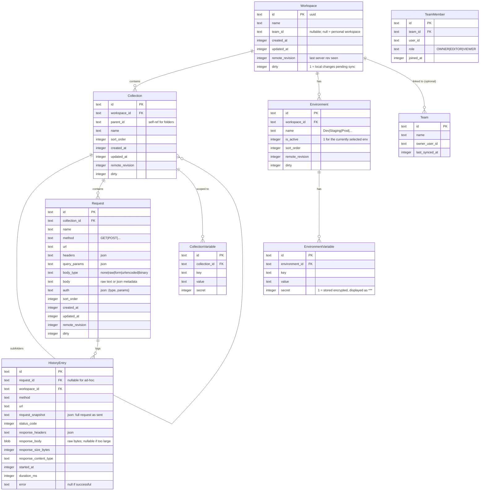

# Tech Stack and Architecture — Volt

> Stage 2 / 5 — Tech stack output
> Previous: `01-product-brief.md`
> Next: `03-roadmap.md`

---

## Stack summary

| Layer | Technology | Why |
|-------|-----------|-----|
| **Desktop shell** | Electron 32 + electron-builder | Only mature path to macOS+Windows+Linux from one codebase; rich Node.js ecosystem (HTTP libs, parsers, SQLite); contextIsolation + sandboxed renderer for security. |
| **Renderer UI** | React 18 + Vite + TypeScript | Fast dev rebuild loop, mature ecosystem, predictable performance characteristics. RSC not relevant in Electron — pure CSR. |
| **UI styling** | Tailwind CSS + shadcn/ui (copy-paste components) | Same reasoning as Masa: no vendor lock, owned design system, small bundle. |
| **State management** | Zustand + TanStack Query | Zustand for local UI state (selected request, panel sizes); Query for server-bound data (collections, history) with optimistic updates. |
| **Local database** | SQLite via better-sqlite3 | Synchronous API (faster for sub-millisecond reads), battle-tested, single file per user, works without daemon. Drizzle ORM on top for type safety. |
| **HTTP engine** | undici (Node.js native fetch) + custom wrappers | Lowest overhead, full streaming support, proper HTTP/2 + HTTP/1.1, integrated with Node fetch API. Avoids axios's overhead and quirks. |
| **Code editor (request body, scripts)** | CodeMirror 6 | Smaller than Monaco, faster to load, good enough for JSON/JS/XML editing. Monaco is overkill for a side-panel editor. |
| **Backend** | NestJS 10 + Prisma 5 + Postgres 16 | Same stack family as Masa for consistency. Different domain model (users + teams, not tenants + restaurants). |
| **Auth** | Lucia 3 + email/password + magic link (post-MVP) | Session-based, server-side. Desktop app stores session token in OS keychain via `keytar`. |
| **API contract** | tRPC | Two TypeScript clients (desktop renderer + future web); type-safe end-to-end without codegen. |
| **Sync transport** | HTTPS polling + Server-Sent Events for push | No WebSockets in MVP. SSE for "your teammate updated something" notifications. Polling fallback if SSE breaks. |
| **Auto-update** | electron-updater + GitHub Releases | Free hosting via GitHub; signed releases; Squirrel on macOS, NSIS on Windows, AppImageUpdate on Linux. |
| **Code signing** | Apple Developer ID + Windows EV cert | Required for non-scary install UX. Linux needs no signing. |
| **Deployment (backend)** | Docker Compose on VPS, Nginx + Postgres + backend | Same Hetzner CPX21 pattern as Masa. |
| **CI/CD** | GitHub Actions + EAS-equivalent for desktop builds | Three platform builds in parallel, code signing in CI via secrets, auto-publish to GitHub Releases. |
| **Telemetry (opt-in)** | Plausible self-hosted or Umami | No third-party SaaS. Just page-event-counts. Never request URLs or bodies. |

**Deliberately rejected:**

- **Tauri** — better baseline performance but Rust HTTP/auth ecosystem is less mature; the engineering cost of rewriting Postman-import logic, OAuth, and WebSocket layers in Rust outweighs the startup-time gain at our stage. Revisit at v2.
- **TanStack Router** — overkill; Electron has no URLs in the user-facing sense. Local route state via Zustand.
- **WebSockets for sync** — adds sticky-session, reconnection complexity, scale-out cost. SSE solves the "push to client" case for less.
- **GraphQL on backend** — tRPC fits our shape better (single TS consumer, no third-party API surface in MVP).
- **MongoDB / NoSQL** — relational model fits collections/requests/responses naturally; we'd just be inventing joins in app code.
- **Monaco editor** — VS Code's editor, gorgeous but 4 MB of JS just to edit a JSON body. CodeMirror 6 is ~200 KB.

---

## Electron architecture

Electron splits an app into two distinct process types, and getting this boundary right is critical for security and performance.

```
┌─────────────────────────────────────────────────────────────────────┐
│                          Electron App                                │
│                                                                      │
│  ┌──────────────────────┐    IPC    ┌──────────────────────────┐    │
│  │  Main Process        │ ◄──────►  │  Renderer Process        │    │
│  │  (Node.js full       │ contextBridge │ (Chromium, sandboxed) │    │
│  │   trust)             │           │                          │    │
│  │                      │           │  - React UI              │    │
│  │  - HTTP request      │           │  - User interaction      │    │
│  │    execution         │           │  - No fs, no node APIs   │    │
│  │  - SQLite read/write │           │  - Uses ipcRenderer only │    │
│  │  - Sync engine       │           │                          │    │
│  │  - File system       │           │                          │    │
│  │  - OS keychain       │           │                          │    │
│  │  - Auto-updater      │           │                          │    │
│  └──────────────────────┘           └──────────────────────────┘    │
│         │                                                            │
│         ├──► better-sqlite3 ───► volt.db (user's local SQLite file) │
│         ├──► undici ───────────► Internet (user's APIs)             │
│         ├──► HTTPS + SSE ──────► api.volt.dev (our backend, sync)   │
│         └──► keytar ───────────► OS Keychain (session tokens)       │
└─────────────────────────────────────────────────────────────────────┘
```

### Why this split matters

**Security:** If we executed user-supplied JavaScript (post-MVP pre-request scripts) or rendered HTML responses in the renderer with full Node access, a malicious API response could read the user's filesystem. The renderer is locked down (`contextIsolation: true`, `nodeIntegration: false`, `sandbox: true`).

**Performance:** HTTP requests execute in the main process via undici. The renderer receives only the parsed response object via IPC — no race between rendering and network I/O.

**Separation of concerns:** Sync logic, auth, database, and file system all live in main. Renderer is "just" a UI shell. This lets us swap the renderer (e.g., to Tauri or a different framework) without rewriting business logic.

### Process layout

```
apps/desktop/
├── electron/                  # Main process — Node.js, full trust
│   ├── main.ts               # Entry point: createWindow, app events
│   ├── ipc/                  # IPC handlers exposed via contextBridge
│   │   ├── request.handler.ts    # request:send, request:cancel
│   │   ├── collection.handler.ts # collection:create, list, update
│   │   ├── history.handler.ts    # history:list, replay, clear
│   │   ├── env.handler.ts        # environment:* CRUD
│   │   ├── auth.handler.ts       # auth:login, logout, refresh
│   │   ├── sync.handler.ts       # sync:start, stop, status
│   │   └── import.handler.ts     # import:postman, insomnia, openapi, curl
│   ├── core/                 # Business logic, framework-agnostic
│   │   ├── http/             # undici wrapper, response parsing
│   │   ├── db/               # Drizzle schema, queries
│   │   ├── sync/             # Sync engine, conflict resolution
│   │   ├── auth/             # Lucia client wrapper, keychain
│   │   └── import/           # Format parsers (Postman, etc.)
│   ├── preload.ts            # Bridges renderer ↔ main via contextBridge
│   └── types.ts              # Shared types between main & renderer
│
├── src/                      # Renderer — React UI, sandboxed
│   ├── main.tsx              # React root
│   ├── App.tsx               # Top-level layout, command palette
│   ├── pages/
│   │   ├── workspace.tsx     # Main pane: collections + request + response
│   │   ├── settings.tsx
│   │   └── teams.tsx
│   ├── components/
│   │   ├── request/          # MethodSelector, UrlInput, HeadersTab, BodyTab
│   │   ├── response/         # StatusBar, BodyViewer, HeadersList, TimingPanel
│   │   ├── sidebar/          # CollectionTree, HistoryList, EnvironmentSelector
│   │   └── ui/               # shadcn primitives (Button, Input, Dialog, ...)
│   ├── hooks/
│   │   ├── use-request.ts    # Send a request via IPC
│   │   ├── use-collections.ts
│   │   ├── use-history.ts
│   │   └── use-shortcuts.ts  # Global keyboard shortcuts
│   ├── stores/               # Zustand
│   │   ├── workspace.store.ts # Selected request, dirty state, layout
│   │   └── command.store.ts   # Command palette state
│   └── styles/
│       └── globals.css
│
├── shared/                   # Types/schemas shared between main & renderer
│   └── ipc-contracts.ts     # Zod schemas for every IPC channel
│
├── electron-builder.yml
├── vite.config.ts
└── package.json
```

### IPC contract (typed end-to-end)

Every IPC channel is defined by a Zod schema in `shared/ipc-contracts.ts`. The preload script auto-generates a typed `window.volt` API for the renderer. This means no string-typed channel names floating around the codebase:

```typescript
// shared/ipc-contracts.ts
export const ipcContracts = {
  'request:send': {
    input: SendRequestInput,    // method, url, headers, body, etc.
    output: SendRequestOutput,  // status, headers, body, timing
  },
  'collection:list': {
    input: z.object({}),
    output: z.array(CollectionSchema),
  },
  // ... etc
};

// renderer usage
const response = await window.volt['request:send']({
  method: 'POST',
  url: 'https://api.example.com/users',
  // ...
});
```

This is the same pattern that protects against typos and bad payloads. Tests can mock individual handlers without touching Electron at all.

---

## Local database schema

The local SQLite file is **the source of truth** for an individual user. The remote Postgres backend is a **sync mirror** — never relied on for the working set.



### Schema decisions

- **Single SQLite file per user** at `~/Library/Application Support/Volt/volt.db` (macOS), `%APPDATA%/Volt/volt.db` (Windows), `~/.config/Volt/volt.db` (Linux). Easy to back up, easy to debug.
- **Snapshot HistoryEntry**, not foreign-keyed to current request fields. If a user changes a request URL, the history still shows the URL it actually sent. Same snapshot reasoning as Masa's `OrderItem`.
- **Response body as BLOB**, with a soft cap of **10 MB** per entry. Anything larger is offered as "save to file" without storing in DB. Prevents the DB file from ballooning when someone hits an endpoint returning a 200 MB JSON dump.
- **`remote_revision` and `dirty` columns** on every syncable table. The sync engine uses these to know what to push and what to fetch.
- **`secret` flag on variables.** Secret values are stored in the OS keychain (via `keytar`), not in the SQLite file. The DB stores only a reference. This means even if someone steals the user's database file, they don't get the API tokens.
- **`is_active` on Environment** is local-only — never synced. Each teammate can have their own "currently selected" environment.
- **Indexes:** `(workspace_id, updated_at)` on Collection, Request, Environment for sync delta queries. `(workspace_id, started_at DESC)` on HistoryEntry for the history list.

### Backend (Postgres) schema

Mirrors the local schema with two differences:

- No `dirty` column (server is authoritative for synced state)
- Adds `User`, `Team`, `TeamInvite`, `Session` tables for multi-user concerns
- Every syncable row has a server-issued `revision` integer that increments on every update — the engine of last-write-wins

The exact Prisma schema is Stage 4 work; this stage just locks the shape.

---

## Sync protocol (last-write-wins)

This is the protocol that has the most subtle bugs in any sync system. Documenting it explicitly here.

### Concepts

**Workspace revision:** an integer that increments every time anything in a synced workspace changes on the server. Both client and server track this.

**Last server revision:** what revision number the client last successfully fetched from the server. Stored in `Workspace.remote_revision`.

**Dirty rows:** local changes not yet pushed to the server. Flagged via the `dirty` column.

### Push (client → server)

When the client has dirty rows:

1. Client collects all dirty rows in the workspace, builds a batch.
2. Client sends `POST /sync/push` with `{ workspaceId, baseRevision, changes: [...] }`.
3. Server validates: is `baseRevision` still current? If yes:
   - Apply each change, increment the workspace revision per change
   - Return `{ newRevision, applied: [...changes with new revision numbers...] }`
4. If `baseRevision` is stale (someone else pushed in between):
   - Server returns `409 Conflict` with the latest revision
   - Client must pull first (see below), then re-attempt push
   - The pull merges with `last-write-wins`: server changes overwrite local where they overlap, then local changes overwrite where they don't

This means: if Alice and Bob both edit the same request offline, the one who pushes first wins. The second push gets a conflict, pulls Alice's version, sees the diff, and the local engine asks the user: **"Your edit was overwritten by Alice 5 minutes ago. Keep theirs or restore yours?"**

### Pull (server → client)

Two modes:

**Polling pull (every 30 seconds when online, configurable):**
1. Client sends `GET /sync/pull?workspaceId=X&since=N` (N = last known revision)
2. Server returns `{ currentRevision, changes: [...changes with revision > N...] }`
3. Client applies changes locally, updates `Workspace.remote_revision = currentRevision`

**SSE push (real-time):**
1. Client opens `GET /sync/stream?workspaceId=X` as Server-Sent Events
2. Server pushes `{ event: 'change', payload: ... }` whenever anything in the workspace changes
3. Client applies the change immediately

SSE is the fast path; polling is the **fallback** that runs unconditionally so we never miss anything even if SSE drops.

### Conflict UI

Every time a local edit is overwritten by a pulled change, the user sees a non-modal banner at the top of the affected request:

> ⚠ Your change was overwritten by Alice (2 min ago).
> [View overwritten version] [Restore mine] [Dismiss]

The overwritten version is kept in a "conflict log" table for 30 days before being purged. Users can review and restore from there.

This is the **trust contract** with users: we'll never silently throw away your work.

### Things deliberately not handled

- **Three-way merge of body text.** If two people edit the same request body offline, one wins entirely. We don't do operational transforms or CRDTs (that's the Local-first variant we rejected). Reason: API request bodies are usually short and a "you lost your changes" banner is acceptable for this use case in a way it wouldn't be for, say, Google Docs.
- **Reordering conflicts.** If two people reorder the same folder, last-write-wins picks one ordering. Annoying but not data-losing.
- **Deletion vs edit.** If Alice deletes a request and Bob edits it offline, the deletion wins. Bob sees: "This request was deleted by Alice. Your changes are saved as `Request name (recovered)`."

---

## Auth and session

### Account model

- **Email + password** for MVP. Magic link login post-MVP.
- **Lucia 3** on the backend (same as Masa, proven).
- **Sessions are server-side** — stored in Postgres, can be revoked instantly. No JWT.
- **Session tokens stored in OS keychain** on the desktop client via `keytar`:
  - macOS: Keychain
  - Windows: Credential Manager
  - Linux: Secret Service (libsecret) — fallback to encrypted file if not available
- **Token rotation:** every successful sync exchanges the current token for a new one with a sliding 30-day expiry. If the user is offline for 30+ days, they need to log in again.
- **Multi-device:** a single account can have multiple active sessions (one per device). User can revoke specific devices from `settings/devices`.

### Desktop login UX

We deliberately don't open a browser for OAuth-style login (that creates a confusing handoff). Instead:

1. User clicks "Sign in" in the app
2. A native panel slides in with email + password fields
3. POST to `/auth/login` → response includes session token
4. Token written to keychain
5. Sync starts in the background

For social login (Google, GitHub) post-MVP, we'll use the standard "open browser → OAuth → custom URL scheme callback `volt://auth/callback?code=...`" flow. That's why `app.json` (electron config) reserves the `volt://` protocol.

---

## Performance budget

This is **the** differentiator. Without enforcement, Electron apps inevitably slide into 5-second startups and 1 GB memory. We treat performance as a hard contract.

### Budgets

| Metric | Target | Enforcement |
|--------|--------|-------------|
| **Cold start (app open → window visible & interactive)** | ≤800 ms on M1/equivalent 2020+ hardware | CI benchmark on every PR, regression fails the build |
| **Time to first paint** | ≤300 ms after window visible | Same |
| **Request "Send" click → response render** | ≤50 ms after response arrived from network | Tracing in dev mode |
| **Switching between collections** | ≤16 ms (one frame) | Manual smoke testing |
| **Idle memory** | ≤200 MB after 10 min idle | Telemetry (opt-in) |
| **Bundle size (uncompressed JS in renderer)** | ≤3 MB initial, ≤8 MB total lazy | bundlesize check in CI |

### How we hit these

- **No splash screen** — splash screens are an admission that startup is slow. We render immediately.
- **Lazy load everything non-critical** — the request editor and response viewer load instantly; settings, teams page, code generator load on demand via `React.lazy()`.
- **Defer SQLite open** — start renderer first, open DB in main process in parallel. Renderer shows empty shell, populates as DB data streams in.
- **Defer sync** — first sync happens 2 seconds after window appears, not before. The user can start sending requests immediately.
- **No global state framework on the critical path** — the URL bar, method selector, and Send button work without any context or store being initialized.
- **Native modules pre-compiled per platform** — better-sqlite3 binaries shipped with the app, no runtime compilation.
- **Single Electron process per app instance** — no per-tab renderers, no service workers, no helper processes beyond the default GPU process.
- **Aggressive tree-shaking** — Vite + manual review of every dependency. No moment.js, no lodash full import, no entire-icon-libraries.
- **Profile in CI** — every PR runs a synthetic launch benchmark on a headless macOS runner. >800ms = red build.

---

## HTTP engine details

Most of the value of an API client lives in the request execution layer. We're using **undici** (Node's modern fetch implementation) with custom wrappers.

### Why undici over alternatives

- **vs axios:** axios has 5+ years of API debt, slower, doesn't expose timing info well, lacks proper streaming.
- **vs got:** great library but heavier, oriented toward server use cases.
- **vs node-fetch:** abandoned, slower, lacks HTTP/2.
- **vs native fetch in Electron renderer:** can't capture detailed timing (DNS, TCP, TLS handshake, time-to-first-byte) which is exactly what a debugging-focused API client needs to show.

### Custom features layered on top

- **Request cancellation:** every request has an AbortController; Cmd/Ctrl+. cancels the active request.
- **Timing breakdown:** we hook into undici's `connect`, `headers`, `body` events to expose DNS / TCP / TLS / TTFB / download phases.
- **Variable substitution:** `{{baseUrl}}/users/{{userId}}` is resolved against the active environment + collection variables before sending.
- **Cookie jar:** opt-in per workspace, in-memory by default (matches Postman behavior).
- **Proxy support:** respects system proxy by default; can be overridden per workspace.
- **Certificate handling:** option to ignore TLS errors per request (dev environments), prominently labeled in UI as a security warning.

### What we don't do in MVP

- HTTP/3 / QUIC (undici doesn't support it yet, complex)
- Custom HTTP client implementations (e.g., raw socket mode for low-level testing) — niche, v1.1+
- Request chaining (the output of one feeds the next) — v1.0 with the scripting feature

---

## Backend architecture

The backend is intentionally minimal. Its only job is to be a reliable mirror of synced workspaces — not a workspace manager, not a request executor, not a documentation host.

```
apps/backend/src/
├── main.ts
├── app.module.ts
├── prisma/
├── auth/                     # Lucia: register, login, logout, sessions, devices
├── user/                     # Profile, password change, delete account
├── team/                     # Create team, invite, accept, remove member, transfer ownership
├── workspace/                # Workspace = top-level shared container
├── sync/
│   ├── sync.controller.ts    # POST /sync/push, GET /sync/pull, GET /sync/stream (SSE)
│   ├── sync.service.ts       # Apply changes, increment revisions, conflict detection
│   └── revision.ts           # Revision counter management
├── trpc/                     # Same pattern as Masa
└── common/
```

### Backend tables (high level)

- `User` — id, email, passwordHash, name, createdAt
- `Session` — Lucia-managed
- `Device` — for "log out this device" feature; userId, label (e.g., "Ahmet's MacBook"), lastSeenAt, sessionId
- `Team` — id, name, ownerId, createdAt
- `TeamMember` — teamId, userId, role (OWNER|EDITOR|VIEWER), joinedAt
- `TeamInvite` — id, teamId, email, code (URL-safe), expiresAt, acceptedAt
- `Workspace` — id, ownerId or teamId (one is null), name, currentRevision (bigint, monotonic)
- `Collection`, `Request`, `Environment`, `EnvironmentVariable`, `CollectionVariable` — mirror local schema, with `revision` column on each row
- `ConflictLog` — id, workspaceId, overwrittenRowId, previousState (json), overwrittenBy, overwrittenAt — retained 30 days, viewable via `/sync/conflicts`

### Sharing model

- A workspace belongs to either a single user (personal) or a team (shared).
- Personal workspaces sync only to that user's devices.
- Team workspaces sync to every team member's devices.
- A user can be in multiple teams, with their own role per team.
- Personal-to-team migration: a user can promote a personal workspace to a team workspace (irreversible without re-creation).

### Endpoints (REST + tRPC overview)

```
POST   /auth/register          email + password + name → 201 + session
POST   /auth/login              email + password → 200 + session + Set-Cookie
POST   /auth/logout             → 204
GET    /auth/me                 → current user + teams + devices

POST   /teams                   create team
POST   /teams/:id/invite        invite by email → 201 + invite code
POST   /teams/invite/:code/accept → join team
DELETE /teams/:id/members/:userId   → kick (OWNER only)

POST   /workspaces              create personal or team workspace
GET    /workspaces              list user's workspaces (personal + team)
PATCH  /workspaces/:id          rename, move to team, etc.

POST   /sync/push               body: { workspaceId, baseRevision, changes[] }
                                  → 200 + new revisions, or 409 if stale
GET    /sync/pull               query: workspaceId, since=N
                                  → { currentRevision, changes[] }
GET    /sync/stream             SSE: pushes change events for subscribed workspace
GET    /sync/conflicts          conflict log for the workspace
POST   /sync/conflicts/:id/restore   restore overwritten version as new revision
```

---

## Build, signing, and distribution

### Build pipeline (per release)

1. **GitHub Actions trigger** on tag push (`v0.1.0`).
2. **Three parallel jobs:** macOS (universal binary), Windows x64, Linux x64.
3. Each job:
   - Install deps, build renderer (Vite), build main (tsc)
   - Run unit tests
   - electron-builder packages → `.dmg`/`.exe`/`.AppImage`+`.deb`
   - Code sign:
     - macOS: signed + notarized with Apple Developer ID (notarization adds ~5 min)
     - Windows: signed with EV cert (or standard cert; EV avoids SmartScreen warning)
     - Linux: no signing; ship `.AppImage` and `.deb`
4. **Upload to GitHub Releases** with checksums.
5. **Trigger `latest.yml` / `latest-mac.yml` / `latest-linux.yml`** for electron-updater to find them.
6. **Update website download links** automatically via a webhook.

Total CI time: ~15 min including notarization. Per-release manual work after the first one: zero, assuming certs are set up and stored as secrets.

### Auto-update flow

- App checks for updates 5 minutes after launch (not blocking startup), then every 4 hours.
- If update available: downloads in background.
- On next app quit/launch, prompts: "Update to v0.x.0? [Restart now] [Later]".
- macOS uses Squirrel (built into electron-updater); Windows uses NSIS; Linux uses AppImageUpdate (or apt for `.deb` users with our repo).

### Code signing reality

- **Apple Developer Program:** $99/year. Notarization is automated via `xcrun notarytool` in CI. Without this, macOS shows scary "this app cannot be opened" warnings.
- **Windows EV code-signing cert:** $300-600/year via DigiCert, Sectigo, etc. Requires a USB token (or HSM in CI). Without this, Windows SmartScreen warns "Unknown publisher" for the first weeks until reputation is built; with EV, the warning is skipped from day one.
- **Linux:** no signing required. We publish a GPG-signed APT repository for `.deb` users post-MVP; AppImage works out of the box.

**For Phase 1 (months 0-6):** ship with Apple Developer + standard Windows cert (not EV) to keep costs down. The SmartScreen warning is unpleasant but transient; we can upgrade to EV once revenue justifies it.

---

## Rationale

### Why Electron over Tauri?

We rejected Tauri earlier in this doc; expanding the reasoning here.

**Tauri's pitch:** smaller binaries (5-20 MB vs Electron's 100+ MB), better baseline RAM (50 MB vs 200 MB), Rust safety guarantees.

**What it costs us:**
- HTTP client features (multipart streaming, proxy with auth, certificate pinning, fine-grained timing) — all need to be re-implemented in Rust or bridged via Tauri commands. The Rust HTTP ecosystem (`reqwest`, `hyper`) is good but not Postman-level mature.
- Parsing libraries: Postman v2.1 JSON schema, Insomnia v4, OpenAPI 3.0 — all have first-class TypeScript libraries (`@postman/schemas`, `@insomnia/importers`, `@apidevtools/swagger-parser`). Rust equivalents are sparse or don't exist.
- Hiring: TypeScript devs are plentiful, Rust + frontend devs are not, especially in our solo-developer phase.
- WebView differences: Tauri uses the OS webview (WebKit on macOS, WebView2 on Windows, WebKitGTK on Linux). Three engines, three sets of subtle bugs. Electron has one (Chromium).

**The honest truth:** Electron has a deserved reputation for being slow, but the slowness comes from apps that don't care. Linear, Raycast, VS Code, Slack-after-2023, and others have shown that disciplined Electron apps can hit native-feeling performance. Our performance budget enforces this.

**Future option:** if Volt grows to the point where Tauri's overhead reduction is meaningful (Phase 3+ with millions of users where binary size and idle RAM matter at scale), we can port. The architectural separation (core logic in `electron/core/` is framework-agnostic) makes this feasible.

### Why SQLite over IndexedDB?

The renderer running in Chromium has IndexedDB available, and we could store everything there.

**Why we don't:**
- IndexedDB is slow for the access patterns we have (lots of small reads on app open). better-sqlite3 is 5-10× faster for our workload.
- IndexedDB is async-everything, including reads. SQLite synchronous reads simplify code dramatically.
- IndexedDB is tied to the Chromium profile. If we ever swap renderers (Tauri future), the data layer must move. With SQLite, the file moves with the app.
- Power-user features: we want to let advanced users open their `volt.db` with `sqlite3` CLI to inspect or back up. IndexedDB is a binary blob in `LevelDB` format inside the Chromium profile — terrible UX.

### Why last-write-wins over CRDT?

We had this conversation in Stage 1. Re-stating the trade-off here for the record:

**LWW pros:** simple to implement (1-2 weeks), simple to debug, fits how users actually edit API requests (one person at a time on a given request 95% of the time).

**LWW cons:** rare-but-real data loss when two people edit the same request offline simultaneously. Mitigation: visible conflict banner + 30-day conflict log + "restore overwritten version" feature.

**CRDT pros:** mathematically guaranteed merge correctness, no data loss.

**CRDT cons:** 3-4 weeks longer to implement, complex to debug (state can diverge in subtle ways), every operation must be modeled as a CRDT primitive, larger storage footprint (operations log), the libraries (Yjs, Automerge) add bundle size.

Given Phase 1 has zero monetization and we're optimizing for shipping a polished MVP, LWW + conflict UI is the right trade-off. We can layer CRDT-style semantics on top of specific fields (e.g., text body editing) in v1.1+ without rewriting the core sync engine.

### Why no built-in scripting in MVP?

Postman's pre-request and test scripts are useful but represent a security and performance liability:

- Sandboxing JS execution properly is hard (most Postman script vulnerabilities have been escapes from their sandbox).
- The "API client that runs arbitrary code" pitch invites bad input from imported collections.
- Adding it later doesn't break anything; removing it later breaks user workflows.

We'll ship scripting in v1.0 with a properly designed sandbox using **Node's vm module + isolated context** plus a small curated API (`pm.environment`, `pm.response`, etc., Postman-compatible to ease migration). MVP ships without it.

---

```json
{
  "desktop": {
    "framework": "Electron 32",
    "renderer": "React 18 + Vite + TypeScript",
    "ui_library": "Tailwind CSS + shadcn/ui",
    "state": "Zustand + TanStack Query",
    "local_storage": "SQLite via better-sqlite3 + Drizzle ORM",
    "http_engine": "undici",
    "editor": "CodeMirror 6",
    "auto_update": "electron-updater + GitHub Releases",
    "code_signing": "Apple Developer ID (macOS), standard cert (Windows), unsigned (Linux)",
    "platforms": ["macOS universal (Intel + Apple Silicon)", "Windows x64", "Linux x64 (deb + AppImage)"]
  },
  "backend": {
    "framework": "NestJS 10",
    "database": "PostgreSQL 16",
    "orm": "Prisma 5",
    "auth": "Lucia 3 (server-side sessions, OS keychain on client)",
    "api_contract": "tRPC + REST (sync endpoints)",
    "deployment": "Docker Compose on VPS, Nginx + Postgres"
  },
  "sync": {
    "strategy": "Last-write-wins with monotonic per-workspace revision counter",
    "transport": "HTTPS push/pull + Server-Sent Events for real-time push notifications",
    "conflict_resolution": "Server-wins on overlap; client shows non-modal banner; overwritten versions kept 30 days for restore"
  },
  "performance_budget": {
    "cold_start_ms": 800,
    "first_paint_ms": 300,
    "send_to_render_ms": 50,
    "idle_memory_mb": 200,
    "initial_bundle_mb": 3,
    "enforcement": "CI benchmark on every PR; bundle size check; manual smoke testing for interactions"
  },
  "rationale": "Electron chosen for ecosystem maturity (HTTP libraries, import parsers, TypeScript talent) over Tauri's raw performance edge; disciplined budget enforcement makes Electron viable. SQLite + Drizzle over IndexedDB for speed, sync simplicity, and user-inspectable database files. Last-write-wins over CRDT to ship faster while mitigating data-loss risk via conflict banners and 30-day overwrite log. undici for first-class HTTP timing and streaming, not axios. NestJS backend matches Masa stack for team familiarity. Three-platform desktop build pipeline via electron-builder + GitHub Actions; auto-update via electron-updater. Performance budget treated as a contract, not a goal: cold start ≤800ms enforced by CI."
}
```
